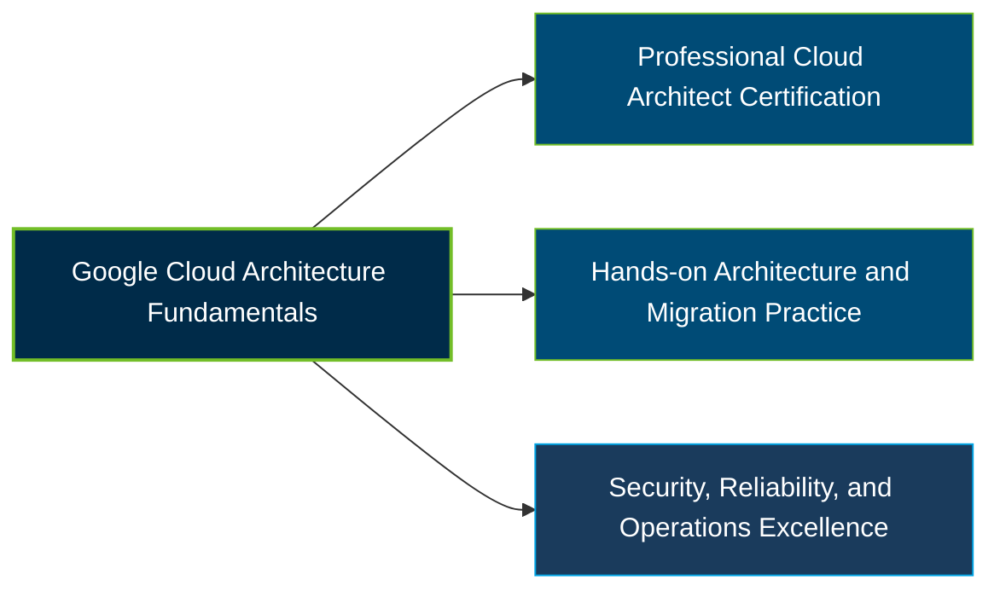

# Google Professional Cloud Architect Certification Exam Guide

[](https://cloud.google.com/learn/certification/cloud-architect)
[](https://cloud.google.com/learn/certification)

A dedicated, comprehensive study guide and cloud architecture reference repository for candidates preparing for the **Google Cloud Professional Cloud Architect Certification Exam**.

---

## Exam Overview

The Google Cloud Professional Cloud Architect certification validates advanced skills in designing, managing, and optimizing secure, scalable, reliable, and cost-effective cloud solutions aligned with business objectives.

- **Exam Format**: Multiple-choice and multiple-select questions; online-proctored or onsite-proctored exam
- **Target Audience**: Cloud Architects, Solutions Architects, Enterprise Architects, and experienced cloud professionals
- **Prerequisites**: None; Google recommends 3+ years of industry experience, including 1+ years designing and managing solutions using Google Cloud

---

## Core Exam Domains & Knowledge Areas

### 1. Designing and Planning a Cloud Solution Architecture

- Designing infrastructure around business, technical, security, and cost requirements.
- Selecting compute, storage, networking, AI, and data services for workloads.
- Planning high availability, scalability, migration, and future improvements.

### 2. Managing and Provisioning a Cloud Solution Infrastructure

- Configuring network topologies, hybrid connectivity, and cloud networking.
- Provisioning compute and storage resources for workload requirements.
- Managing container orchestration, serverless services, and AI/ML infrastructure.

### 3. Designing for Security and Compliance

- Designing IAM, resource hierarchy, encryption, and access controls.
- Applying security policies, auditing, and software supply-chain protections.
- Addressing regulatory, data privacy, sovereignty, and industry compliance requirements.

### 4. Analyzing and Optimizing Technical and Business Processes

- Improving software development, CI/CD, testing, and troubleshooting processes.
- Planning disaster recovery, business continuity, and operational workflows.
- Evaluating stakeholder needs, change management, and cost optimization.

### 5. Managing Implementation

- Advising development and operations teams on application and infrastructure deployment.
- Applying API management, testing, migration, and deployment practices.
- Using Google Cloud SDKs, APIs, Cloud Shell, and infrastructure as code.

### 6. Ensuring Solution and Operations Excellence

- Applying operational excellence principles from the Google Cloud Well-Architected Framework.
- Using monitoring, logging, profiling, and alerting to assess workload health.
- Improving release management, production reliability, and quality control.

---

## Certification Path



This is a suggested learning progression, not an official prerequisite or mandatory certification sequence.

---

## Recommended Practice & Study Resources

Combine official Google Cloud learning materials with hands-on architecture exercises to prepare for the Professional Cloud Architect exam.

- **CertsGate**: Explore [Google Professional Cloud Architect exam preparation resources](https://certsgate.com/exams/google/professional-cloud-architect) for supplementary study materials and practice questions.
- **Google Cloud Well-Architected Framework**: Study the [official framework documentation](https://cloud.google.com/architecture/framework) and apply its guidance to security, reliability, performance, cost, and operational decisions.
```
